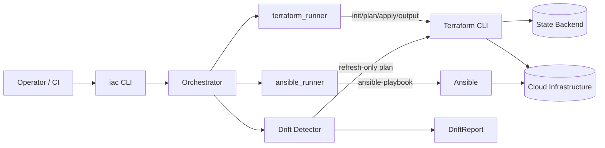

# Infrastructure Automation Framework

A Python framework and CLI (`iac`) that orchestrates Terraform and Ansible,
with built-in infrastructure drift detection.

[](LICENSE)
[](https://github.com/abhisheksawant52/infrastructure-automation-framework/actions/workflows/ci.yml)
[](https://www.python.org/)
[](https://github.com/psf/black)
[](https://www.terraform.io/)
[](https://www.ansible.com/)

## Overview

Most infrastructure teams end up gluing Terraform and Ansible together with
ad hoc shell scripts: one script to plan and apply, another to run the
playbook afterwards, and no consistent way to tell whether production has
quietly drifted away from what's checked into version control.
`infrastructure-automation-framework` replaces those scripts with a single,
typed Python framework that wraps both tools' CLIs, standardizes how
environments are provisioned and configured, and reports drift as a
first-class, structured result rather than a wall of Terraform plan text.

It is aimed at platform and DevOps engineers who manage multiple
environments (`dev`, `staging`, `prod`) with Terraform and Ansible and want a
consistent automation layer — usable from a terminal, a cron job, or a CI
pipeline — on top of both.

The framework does not replace Terraform or Ansible; it orchestrates them.
The `terraform/` and `ansible/` directories in this repository are example
managed assets showing the layout the framework expects.

## Architecture



Components:

- **CLI (`iac`)** — Click entrypoint exposing `plan`, `apply`, `drift`, and
  `ansible` subcommands.
- **Orchestrator** — resolves per-environment configuration and coordinates
  the runners and drift detector.
- **`terraform_runner`** — typed subprocess wrapper around
  `terraform init/plan/apply/output`, parsing CLI output into
  `PlanSummary` / `ResourceChange` models.
- **`ansible_runner`** — typed subprocess wrapper around `ansible-playbook`,
  with inventory and extra-vars handling.
- **Drift detector** — runs a `-refresh-only` plan and classifies the result
  into a `DriftReport` (`in_sync`, `drifted`, `error`).
- **State backend** — Terraform remote state (S3-compatible by default; see
  `terraform/versions.tf`), shared across runs.

## Features

- Single CLI (`iac`) for provisioning, configuration, and drift detection
  across named environments.
- Typed, documented wrappers around the Terraform and Ansible CLIs — no
  string-templated shell scripts.
- Structured drift reports (`DriftReport`, `DriftStatus`) suitable for
  alerting or dashboards, not just raw plan text.
- Environment-aware configuration via `pydantic-settings`, driven entirely
  by environment variables (`IAC_*`).
- Example, valid Terraform root module (with a `network` submodule) and
  Ansible playbook (with a `common` role) showing the expected asset layout.
- Ships as an installable console script (`iac`) and a container image.

## Tech Stack

Python 3.11+ · Click · Pydantic / pydantic-settings · Terraform · Ansible ·
pytest · ruff · black · GitHub Actions · Docker

## Getting Started

### Prerequisites

- Python 3.11 or newer
- Terraform >= 1.5 (for actual `plan`/`apply`/drift runs)
- Ansible (for actual `ansible-playbook` runs)
- `make` (optional, for convenience targets)

### Install

```bash
python -m venv .venv && source .venv/bin/activate
make install            # pip install -e .[dev]
cp .env.example .env    # adjust working dirs / backend / environments
```

### Run

```bash
# Plan an environment
iac plan --env dev

# Apply infrastructure changes
iac apply --env dev

# Run the Ansible configuration stage
iac ansible --env dev

# Detect drift (exit code 1 if drift found, 2 on error)
iac drift --env prod
```

## Project Structure

```
.
├── src/iac_framework/          # framework implementation
│   ├── cli.py                  # Click entrypoint (plan/apply/drift/ansible)
│   ├── config.py                # pydantic-settings configuration
│   ├── logging_config.py        # logging setup
│   ├── models.py                 # PlanSummary, ResourceChange, DriftReport, DriftStatus
│   ├── terraform_runner.py       # typed terraform CLI wrapper
│   ├── ansible_runner.py         # typed ansible-playbook wrapper
│   ├── drift.py                  # drift detection logic
│   └── orchestrator.py           # coordinates terraform + ansible per environment
├── terraform/                   # example managed root module
│   ├── main.tf / variables.tf / outputs.tf / versions.tf / providers.tf
│   ├── modules/network/          # example submodule (VPC + public subnets)
│   └── environments/dev|prod/    # per-environment tfvars
├── ansible/                      # example managed playbook + inventory
│   ├── ansible.cfg
│   ├── inventory/hosts.ini
│   ├── site.yml
│   └── roles/common/              # baseline configuration role
├── docs/                         # architecture and operational runbook
├── tests/                        # pytest suite
├── Dockerfile                    # multi-stage, non-root image for the iac CLI
└── .github/workflows/ci.yml      # this project's own pipeline
```

## Configuration

All configuration is environment-variable driven (prefix `IAC_`); see
[`.env.example`](.env.example) for the full list.

| Variable | Default | Description |
| --- | --- | --- |
| `IAC_TERRAFORM_DIR` | `terraform` | Root directory of the managed Terraform module. |
| `IAC_ANSIBLE_DIR` | `ansible` | Root directory of the managed Ansible assets. |
| `IAC_DEFAULT_ENVIRONMENT` | `dev` | Environment used when `--env` is omitted. |
| `IAC_BACKEND_TYPE` | `local` | Terraform backend type (e.g. `s3`, `azurerm`). |
| `IAC_BACKEND_BUCKET` | _(none)_ | Backend storage bucket/container, if required. |
| `IAC_BACKEND_REGION` | _(none)_ | Backend region, if required. |
| `IAC_TERRAFORM_BINARY` | `terraform` | Path/name of the Terraform executable. |
| `IAC_ANSIBLE_BINARY` | `ansible-playbook` | Path/name of the Ansible executable. |
| `IAC_LOG_LEVEL` | `INFO` | Root logging level. |

## Deployment

The `iac` CLI itself ships as a container image (see [`Dockerfile`](Dockerfile),
a multi-stage, non-root build) so it can run as a CI job or scheduled task
without a local Python install:

```bash
docker build -t iac-framework .
docker run --rm -v "$PWD:/workspace" -w /workspace iac-framework plan --env dev
```

The infrastructure it manages is described in [`terraform/`](terraform/)
(root module + `modules/network` + per-environment tfvars under
`environments/`) and [`ansible/`](ansible/) (inventory, playbook, and the
`common` role). See [`docs/architecture.md`](docs/architecture.md) for the
full data flow and [`docs/runbook.md`](docs/runbook.md) for day-to-day
operational procedures, including how to respond to detected drift.

## Contributing

Contributions are welcome — see [CONTRIBUTING.md](CONTRIBUTING.md) and our
[Code of Conduct](CODE_OF_CONDUCT.md).

## Security

Please report vulnerabilities as described in [SECURITY.md](SECURITY.md).

## License

Released under the [MIT License](LICENSE).
